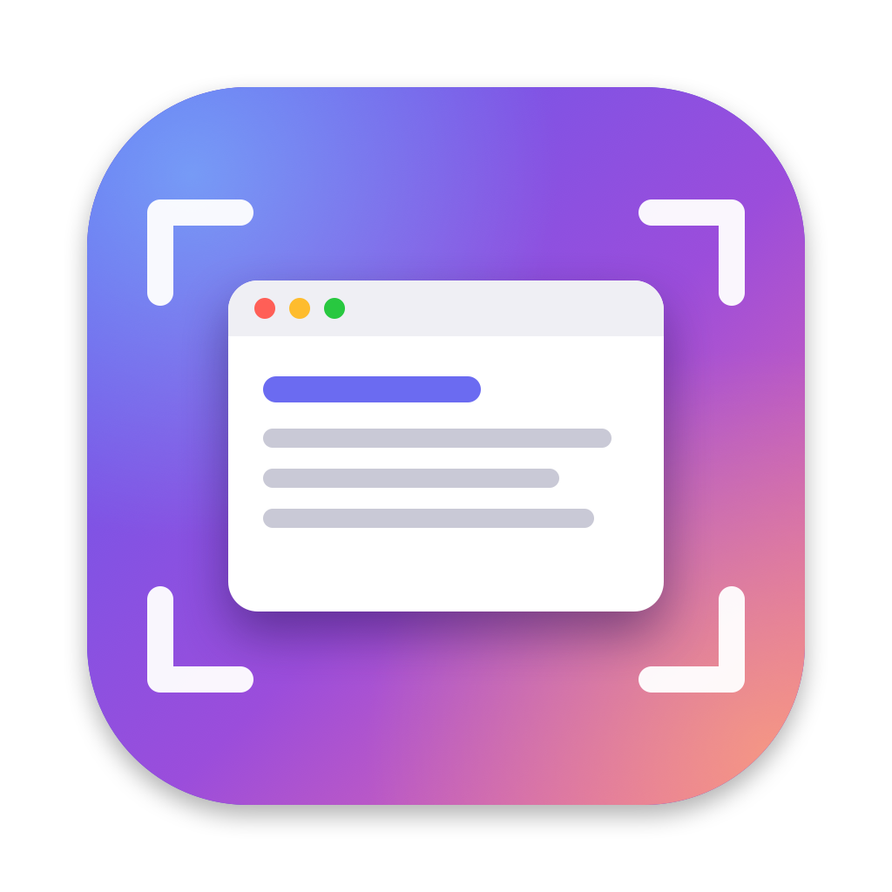
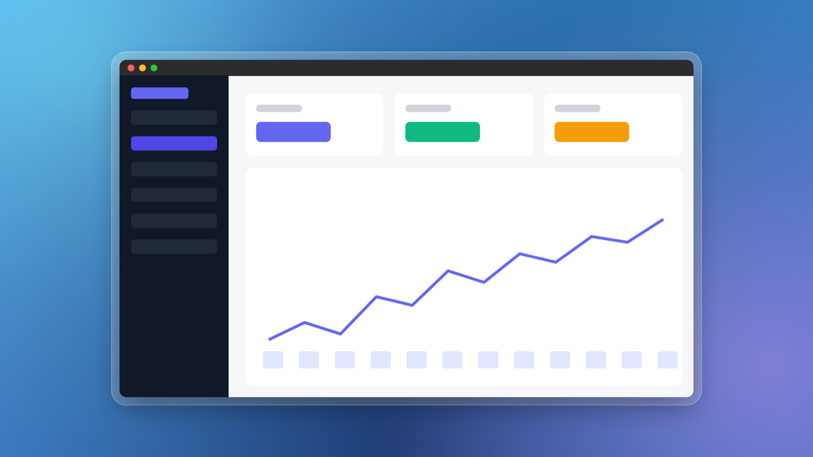
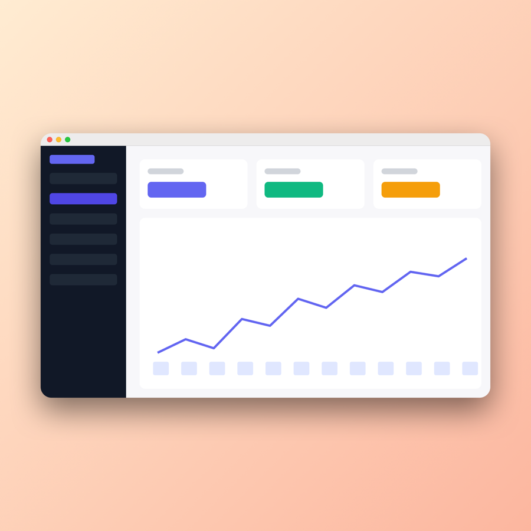
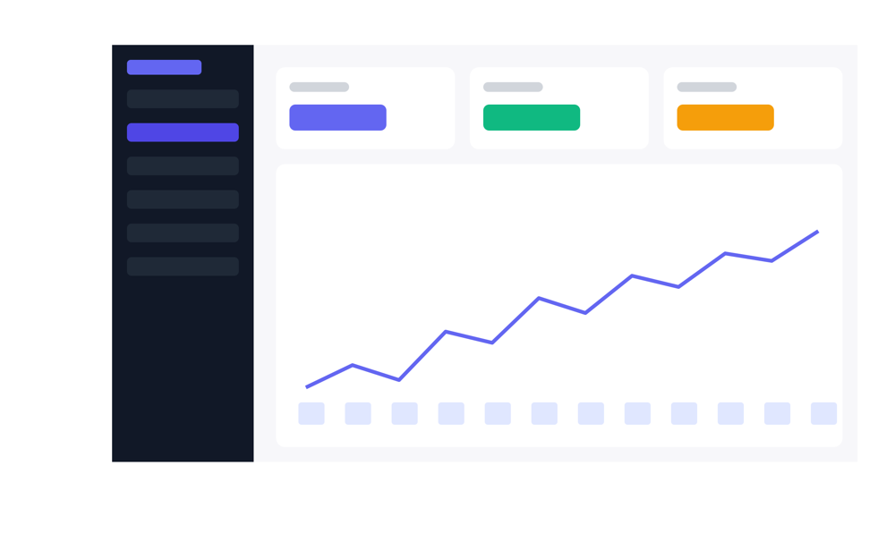

<p align="center">
  
</p>

<h1 align="center">Screenshotty</h1>

<p align="center">
  Beautiful, perfectly centred screenshots for macOS.<br>
  Capture, drop it on a gorgeous background, post it. Free and open source.
</p>

<p align="center">
  
</p>

## Why

Default macOS screenshots look flat. They have no padding, no background and are often off-centre.
Screenshotty turns them into the kind of polished product shots you see SaaS founders post, in one shortcut.

## Features

- **Capture with one shortcut.** Press <kbd>⌘</kbd><kbd>⇧</kbd><kbd>2</kbd> and select an area. Press <kbd>Space</kbd> to pick a window. It is the same picker as the built-in screenshot tool.
- **Never leak a secret.** Emails, API keys, tokens, card and phone numbers and IP addresses are found on your Mac (nothing is uploaded) and hidden in one click, with a solid bar or blur. Turn on Auto-hide once and every later capture is covered automatically.
- **Styles.** One-click looks for X, LinkedIn, Instagram, product launches, mobile apps, MacBook shots and docs, each with an exact export size. Save your own look as a style. Batch Export applies a style to a whole folder of screenshots.
- **Browser frames and mockups.** A Safari-style window with your URL in the address bar, or a MacBook or iPhone drawn around the screenshot. They can be combined, like a browser on a MacBook.
- **Quick preview.** After each capture a small card slides in at the bottom-left with the finished image. Copy, save, edit, or drag it straight into another app. It slides away on its own.
- **Fixes sloppy captures.** Grabbed a few pixels of desktop or a neighbouring window, or half of a sidebar's labels? Slivers and content cut off by the edge are removed automatically. Hold **Compare** in the editor to see the capture as it was taken.
- **Crop.** Press <kbd>C</kbd> in the editor to choose exactly which part of the capture to show. Drag any edge or corner, or drag the box to move it.
- **Auto-trim and balance.** Uneven plain margins are removed and replaced with an even inner margin in the screenshot's own background colour. Tight crops of text get breathing room, and rounded corners never clip your content. The result is centred to the pixel.
- **Smart backgrounds, on by default.** Vibrant, mesh, pastel and dark looks generated from your screenshot's main accent colour. Every new capture gets its own matching background.
- **Backgrounds.** 16 gradients, 8 mesh wallpapers, solid colours, your own image or desktop wallpaper (with blur), or transparent. Images you've used stay under Recent, one click away.
- **Social-ready sizes.** Auto (follows the shot, but very wide or tall shots get extra padding so they never post as a thin strip), 1:1, 4:5, 4:3, 3:2, 16:9, 1.91:1 (LinkedIn and Open Graph) and 9:16.
- **Styling.** Rounded corners, soft to strong shadows, macOS window chrome in light or dark, and a hairline or frosted-glass frame.
- **Annotations.** Arrows, highlight boxes, blur and redact, drawn straight on the preview. They stick to your content even when you change the trim, size or background. Redact covers the area with a solid bar, so use it for anything secret.
- **Fast export.** <kbd>⌘</kbd><kbd>C</kbd> to copy, <kbd>⌘</kbd><kbd>S</kbd> to save, or drag the image straight into Slack, X, Figma or Finder.
- **Sharp on every network.** Small captures are enlarged pixel-for-pixel on export, so text stays crisp after X, LinkedIn or Slack resize them.
- **Instant mode.** Optionally skip the preview and copy or save with your last style right after capturing.
- **Also works on existing images.** Open any image, paste from the clipboard, or drop a file onto the editor.
- **Command line.** `Screenshotty render input.png --preset ocean --aspect 16:9` for scripts and automation.

<p align="center">
  
  
</p>
<p align="center"><sub>Left: 1:1 export. Right: the original capture, with uneven white margins.</sub></p>

## Install

Requires macOS 14 Sonoma or later. Works on Apple Silicon and Intel Macs.

### Option 1: one-line install (easiest)

```bash
curl -fsSL https://raw.githubusercontent.com/harrison-bbb/screenshotty/main/scripts/install.sh | bash
```

This downloads the latest release into `/Applications` and opens it.

### Option 2: Homebrew

```bash
brew tap harrison-bbb/screenshotty https://github.com/harrison-bbb/screenshotty
brew install --cask screenshotty
```

### Option 3: download

1. Download **Screenshotty.dmg** from the [latest release](https://github.com/harrison-bbb/screenshotty/releases/latest).
2. Drag Screenshotty into Applications.
3. Open it. Screenshotty is free and isn't signed with a paid Apple Developer certificate, so macOS will warn you the first time. Open **System Settings → Privacy & Security**, scroll down and click **Open Anyway**.

Alternatively, run this once after copying it to Applications:

```bash
xattr -dr com.apple.quarantine /Applications/Screenshotty.app
```

### First capture

macOS asks for **Screen Recording** permission the first time you capture. Turn on Screenshotty in
**System Settings → Privacy & Security → Screen & System Audio Recording**, then quit and reopen Screenshotty.

### Troubleshooting

**Captures come out as just the background.** macOS is blocking the capture, usually because permission was
given to an older copy of the app. Screenshotty detects this and offers **Reset Permission**. You can also go to
**Settings → Screen Recording → Reset**. Screenshotty restarts and macOS asks again. Version 0.1.1 and later
keep the permission across updates.

Diagnostics are written to `~/Library/Logs/Screenshotty.log`. Please attach it when you file an issue.

## Usage

| Action | Shortcut |
| --- | --- |
| Capture area or window (global) | <kbd>⌘</kbd><kbd>⇧</kbd><kbd>2</kbd> (change it in Settings) |
| Copy image | <kbd>⌘</kbd><kbd>C</kbd> |
| Save to your save folder | <kbd>⌘</kbd><kbd>S</kbd> |
| Save as | <kbd>⌘</kbd><kbd>⇧</kbd><kbd>S</kbd> |
| Replace screenshot from clipboard | <kbd>⌘</kbd><kbd>V</kbd> |
| New capture (while the editor is open) | <kbd>⌘</kbd><kbd>N</kbd> |
| Select, Arrow, Box, Blur, Redact | <kbd>V</kbd> <kbd>A</kbd> <kbd>B</kbd> <kbd>U</kbd> <kbd>R</kbd> |
| Crop | <kbd>C</kbd>, then <kbd>Return</kbd> to apply or <kbd>Esc</kbd> to cancel |
| Undo / redo annotation | <kbd>⌘</kbd><kbd>Z</kbd> / <kbd>⌘</kbd><kbd>⇧</kbd><kbd>Z</kbd> |
| Delete selected annotation | <kbd>⌫</kbd> |

Everything else lives in the menu bar icon: full-screen capture, open an image, beautify the clipboard image, batch export and settings.

### Command line

The app binary doubles as a command line tool:

```bash
alias screenshotty=/Applications/Screenshotty.app/Contents/MacOS/Screenshotty
screenshotty render shot.png -o pretty.png --preset tahoe --aspect 16:9 --chrome dark --frame glass
screenshotty render shot.png --smart mesh
screenshotty render shot.png --style launch --url yourapp.com --redact
screenshotty render phone.png --device iphone --aspect 4:5 --width 1080
screenshotty render --help
```

## Build from source

You only need the Xcode Command Line Tools (`xcode-select --install`). Full Xcode works too.

```bash
git clone https://github.com/harrison-bbb/screenshotty.git
cd screenshotty
scripts/build-app.sh
open build/Screenshotty.app
```

Run the tests with `scripts/test.sh`. See [CONTRIBUTING.md](CONTRIBUTING.md) for how the code is organised.

## Roadmap

- Capture history with search by the text inside each screenshot
- Copy text from a screenshot (on-device OCR)
- Text labels, numbered steps, spotlight and magnifier annotations
- Self-timer, scrolling capture and "capture the same area again"
- JPEG and WebP export that fits each platform's size limit
- Windows version (the style format is documented in [docs/composition-format.md](docs/composition-format.md) so it can share presets)

Ideas and pull requests are welcome.

## License

[MIT](LICENSE)
